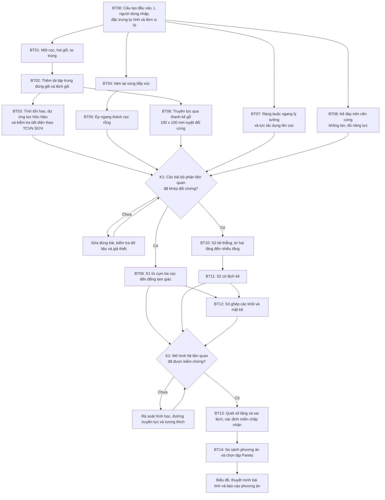
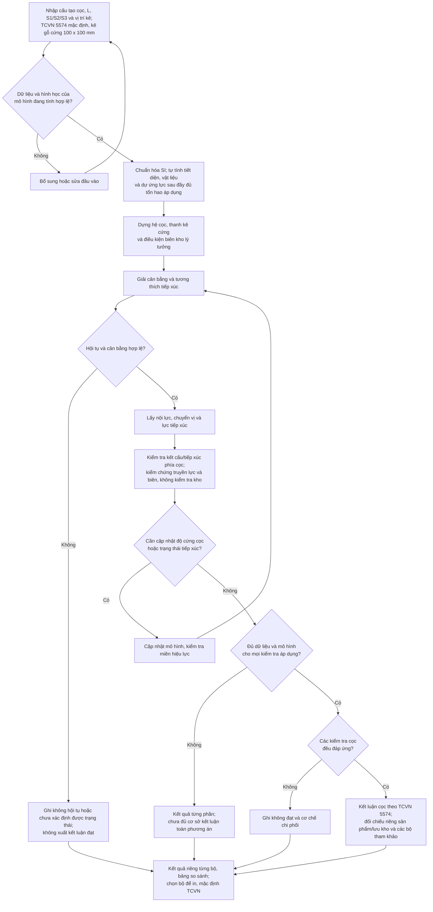
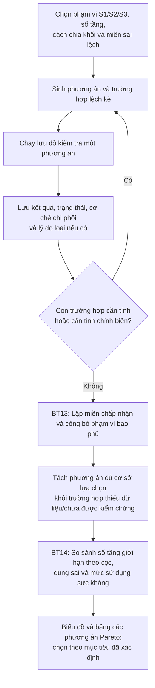

# Kế hoạch phát triển: Web App Tính toán & Đánh giá Xếp cọc Bê tông Ly tâm trong Kho

**Phiên bản kế hoạch:** 0.5.0 — cập nhật ngày 16/11/2026.
**Trạng thái:** Đặc tả trước triển khai; chưa có kết quả tính toán định lượng được kiểm chứng.

## 1. Mục tiêu và phạm vi

Xây dựng ứng dụng web tĩnh để kiểm tra, so sánh và tìm phương án xếp cọc theo ba sơ đồ tại mục 2. Kết quả gồm nội lực, chuyển vị, phản lực, lực tiếp xúc, mức sử dụng khả năng chịu lực, số tầng và dung sai đặt kê tương ứng.

- Xác định giới hạn tính toán theo mô hình, dữ liệu và các trường hợp đã kiểm chứng; thể hiện cơ chế chi phối kết quả.
- Giữ riêng kết quả kiểm tra cơ học, đối chiếu tiêu chuẩn áp dụng và phương án đề nghị sử dụng.
- Ưu tiên **TCVN 5574:2018** để tính kết cấu cọc, đặc trưng vật liệu thiết kế và dự ứng lực sau tổn hao; TCVN là cơ sở đánh giá và báo cáo mặc định. Các tiêu chuẩn khác phục vụ tham khảo, đối chiếu; cho phép chọn tính song song nhiều tiêu chuẩn ở những bài toán có hỗ trợ và chọn tiêu chuẩn để in báo cáo theo nhu cầu.
- Tính lại đặc trưng tiết diện, tự trọng, ứng suất hữu hiệu, mômen nứt, sức kháng uốn/cắt và các giới hạn từ cấu tạo cọc, vật liệu và quá trình căng/truyền lực được khai báo. Các thông số kỹ thuật công bố trên bản vẽ chỉ để tham khảo, không dùng thay kết quả tính.
- Chiều dài cọc `L` là biến do người dùng nhập; không xét đóng góp của thép dọc gia cường đầu cọc. Thanh kê kho là gỗ tiết diện **100 × 100 mm**, mô hình **tuyệt đối cứng**, không kiểm tra sức chịu tải hay biến dạng thanh gỗ; toàn bộ lõi tính toán dùng hệ SI với m, kg, s và các đơn vị dẫn xuất N, Pa.
- Tìm quan hệ giữa số tầng, cách chia khối xếp và độ lệch kê theo **khả năng chịu lực của cọc**. Kho được giả thiết đủ năng lực, không giới hạn diện tích, tải nền, năng lực chèn giữ hay tài nguyên kê; không thiết kế/kiểm tra kho và không tối ưu sức chứa theo diện tích bãi.
- Quy trình sản xuất đã chốt: **căng trước bằng máy cơ khí tại nhà máy**, thép cắt theo chiều dài cần thiết để đạt lực căng/độ giãn dài của cọc yêu cầu; bê tông dưỡng hộ trong hầm sấy vài giờ, sau đó đưa ra tháo khuôn và tiếp tục dưỡng hộ tự nhiên. Không dùng phương pháp căng nhiệt hoặc nhiệt–điện; các ảnh hưởng của dưỡng hộ hầm sấy được xác lập riêng trong tính tổn hao.
- Phạm vi khởi đầu đề xuất: cọc PHC thẳng, trục song song, cùng đường kính, chiều dày và chiều dài trong một đống; tải trọng lưu kho tĩnh. Các trường hợp khác cần được định nghĩa và kiểm chứng trước khi mở rộng.
- Giai đoạn nâng, hạ, vận chuyển và va chạm là các trường hợp tải riêng nếu bổ sung; không dùng trực tiếp hệ số của các giai đoạn đó cho mọi trường hợp lưu kho.

## 2. Ba sơ đồ kê bắt buộc hỗ trợ

Quy ước: trục x dọc cọc, y ngang bãi, z thẳng đứng. Một cặp gối/thanh kê gồm hai vị trí dọc cọc x1 và x2; mỗi thanh là gỗ tiết diện vuông `b_x = h_z = 0,1 m`. Cần khai báo chiều dài thanh theo y và phạm vi các cọc mà thanh thực sự đỡ; chiều dài thanh khác chiều dài cọc `L` do người dùng nhập.

| Mã | Sơ đồ | Dữ liệu hình học cần có | Trọng tâm kiểm tra |
|---|---|---|---|
| S1 | Các cọc xếp tam giác, tỳ trực tiếp lên nhau; chỉ tầng đáy đặt trên hai gối/thanh kê | Số cọc từng hàng, tọa độ tâm cọc, vị trí hai kê đáy và ràng buộc biên lý tưởng | Lực tiếp xúc nghiêng, uốn dọc, ép ngang thành cọc và lực truyền về biên lý tưởng |
| S2 | Hai gối/thanh kê ở mọi tầng, bố trí thẳng đứng từ trên xuống dưới; khảo sát lệch kê | Số cọc từng tầng; x1, x2 của từng mặt kê; chiều dài/phạm vi đỡ của thanh kê gỗ cứng 100 × 100 mm | Uốn và cắt cọc do tải truyền lệch vị trí, ứng suất/nứt, tiếp xúc phía cọc và phản lực kê |
| S3 | Hỗn hợp: vài tầng tỳ trực tiếp, sau đó một mặt có hai kê, rồi tiếp tục xếp trực tiếp | Số tầng mỗi khối, ví dụ [3, 2, 3]; mặt đặt kê, số cọc từng hàng và vị trí các kê | Tải tích lũy qua nhiều khối, tiếp xúc ở mặt chuyển tiếp, vị trí tầng chèn kê và dung sai |

### 2.1. Cách biểu diễn thống nhất

- Khai báo từng tầng cọc và từng mặt tiếp giáp: tiếp xúc trực tiếp hoặc qua cặp thanh kê. Tầng đáy có cặp kê nền ở cả ba sơ đồ.
- Chuỗi số tầng mỗi khối chỉ là cách nhập nhanh cho S3; vẫn phải kiểm tra số cọc từng hàng, bề rộng, cao độ và tính khả thi hình học tại mặt chuyển tiếp.
- Mỗi tiếp xúc phải biết hai đối tượng, vị trí/phạm vi dọc cọc, hướng pháp tuyến và đặc tính tiếp xúc.
- Thanh kê trung gian truyền tiếp tải xuống dưới; không làm mất tải tích lũy và không được coi là một nền độc lập.
- Tiếp xúc trực tiếp giữa các cọc có thể kéo dài dọc thân. Không mặc định mọi tải chỉ tác dụng tại hai vị trí kê đáy hoặc phân bố đều trên toàn chiều dài.

## 3. Mô hình cơ học

### 3.1. Cọc, thanh kê và đường truyền lực

- Mô hình cọc bằng phần tử dầm phù hợp, xét dự ứng lực trong kiểm tra tiết diện. Phải xét được tải theo cả hai phương ngang và đứng khi lực tiếp xúc nghiêng của S1/S3 yêu cầu; một mô hình dầm chỉ chịu uốn đứng không đủ cho mọi sơ đồ.
- Mô hình cấu tạo tiết diện là hàm theo tọa độ dọc trục cọc `section(x)`: phân biệt **vùng đầu cọc** (đoạn `L_dau`, đai xoắn bước dày / nhiều dây theo cấu tạo được xác nhận) với **vùng thân giữa** (đai xoắn bước thưa). Chỉ xét bê tông, thép dự ứng lực và đai xoắn trong mô hình tính đã chọn; **không xét thép dọc gia cường đầu cọc `N2, ØGC, L2`** khi tính tiết diện quy đổi, độ cứng, tổn hao và sức kháng. Việc bỏ thép gia cường không làm mất phân vùng đai tại tọa độ mặt cắt và vị trí kê `x1, x2`.
- Tự tính diện tích, mômen quán tính, môđun chống uốn, diện tích thép, khối lượng dài và tự trọng từ hình học/vật liệu đầu vào đã xác lập. Khối lượng và sức chịu tải công bố trên bản vẽ chỉ dùng đối chiếu, không đi vào lõi tính; phân biệt khối lượng riêng `ρ` (kg/m³) với trọng lượng thể tích `γ = ρg` (N/m³).
- Mô hình thanh kê gỗ 100 × 100 mm là vật rắn tuyệt đối; không cần môđun/sức kháng gỗ và không kiểm tra sức chịu tải/biến dạng thanh gỗ. Giữ chiều dài, kích thước, vị trí và các tiếp xúc để giải cân bằng, chuyển động vật rắn và tương thích với cọc. Kê đáy đặt trên nền kho cứng lý tưởng, không lún và không giới hạn sức chịu tải; thanh cứng không có nghĩa phản lực trên mọi cọc bằng nhau.
- Tính cân bằng và tương thích biến dạng của hệ cọc–kê–tiếp xúc. Không quy đổi mặc định n tầng thành tải phân bố n lần tự trọng trên mọi cọc.
- Xét từng cọc, từng tầng và từng tiếp xúc; không mặc định cọc ở tầng thấp nhất luôn chi phối tất cả kiểm tra.

### 3.2. Tiếp xúc và điều kiện biên lý tưởng

- Tiếp xúc cọc–cọc và cọc–kê chỉ truyền nén theo phương pháp tuyến; cho phép tách khi mất tiếp xúc. Lực tiếp xúc và độ hở phải thỏa điều kiện không xuyên qua, không chịu kéo và điều kiện bổ sung của bài toán tiếp xúc.
- Trong các sơ đồ có tiếp xúc trực tiếp dọc thân (S1 và khối xếp trực tiếp của S3), phải rời rạc hóa các cặp nút tiếp xúc một phía (unilateral contact) dọc theo các phần tử dầm theo trục `x` trong `contact_solver.js` để bắt được hiện tượng chênh lệch độ võng uốn giữa các tầng gây tách hở cục bộ và tập trung lực tiếp xúc về gần vùng gối kê `x1, x2`.
- Phân bố lực khi có nhiều tiếp xúc phụ thuộc độ cứng và biến dạng; không gán tỷ lệ 50/50 cho mọi trạng thái.
- Không yêu cầu dữ liệu địa kỹ thuật, độ cứng/sức chịu tải nền hay sức chịu tải chèn giữ. Chống trượt/lăn/xòe chân của kho được giả thiết đáp ứng bằng ràng buộc biên lý tưởng có năng lực không giới hạn; sơ đồ phải ghi vị trí, hướng và tiếp xúc của các ràng buộc này để xác định lực tác dụng lên cọc. Không thay chúng bằng khóa chuyển vị tùy ý trên mọi cọc.
- Mặc định các tiếp xúc trong bài toán cơ học truyền lực pháp tuyến, không dựa vào ma sát để tạo cân bằng; điều kiện giữ biên nằm trong sơ đồ lý tưởng. Vẫn giải tiếp xúc một phía, lực ngang và cân bằng của cọc/hệ; trạng thái hình học hoặc tiếp xúc không có nghiệm hợp lệ được báo là giới hạn mô hình, không chuyển thành bài kiểm tra sức chịu tải kho.
- Xuất phản lực tại kê đáy/ràng buộc biên để kiểm tra đường truyền lực, không so với khả năng chịu tải nền/chèn và không dùng năng lực kho làm cơ chế giới hạn số tầng.
- Lưu trạng thái hội tụ, cân bằng lực/mômen và tập tiếp xúc đang hoạt động cho từng phương án.

### 3.3. Các kiểm tra sức bền

1. **Dọc cọc:** ưu tiên tính uốn, cắt, ứng suất bê tông, hình thành/độ mở nứt và chuyển vị theo TCVN 5574:2018, dùng dự ứng lực sau đầy đủ tổn hao áp dụng. Tự xác định mômen nứt, mômen cực hạn và sức kháng thiết kế từ cấu tạo/vật liệu; phân biệt rõ định nghĩa từng giá trị, không dùng `M_cr/M_u` trên bản vẽ làm ngưỡng tính. Kiểm tra cắt phải sử dụng đúng hàm lượng đai xoắn và thép dự ứng lực theo vùng `section(x)`, bỏ thép dọc gia cường đầu cọc (đặc biệt vị trí gần kê `x1, x2` có thể rơi vào vùng đai thưa ở thân giữa).
2. **Tiếp xúc cục bộ:** kiểm tra nén và biến dạng cục bộ phía cọc tại diện tiếp xúc với thanh kê cứng hoặc cọc khác; xác định diện tiếp xúc thực tế từ hình học và mô hình phía cọc, không tính nén/biến dạng gỗ.
3. **Thành cọc rỗng:** uốn theo vòng, nứt và ép vỡ cục bộ theo hàm lượng đai vòng thực tế tại vùng tiếp xúc `section(x)`. Dự ứng lực dọc không được tự coi là dự ứng lực vòng; kiểm tra ứng suất trung bình R/A không thay thế kiểm tra này.
4. **Kê/chèn/nền:** chỉ là điều kiện biên/truyền lực lý tưởng, đủ năng lực; không kiểm tra uốn, cắt, nén, biến dạng gỗ, sức chịu tải chèn/nền hoặc lún kho. Vẫn kiểm tra tiếp xúc và ứng suất **phía cọc**. Kết luận đầu ra là khả năng chịu của cọc trong sơ đồ biên đã khai báo, không phải thiết kế hay đánh giá toàn kho.

Mô hình vòng đàn hồi có thể dùng để sàng lọc ép ngang. Trường hợp tiếp xúc hữu hạn, tương tác ứng suất hoặc nứt phức tạp cần mô hình shell/solid và/hoặc thí nghiệm để kiểm chứng. Bảng tra hay mô hình rút gọn trên web phải công bố miền hiệu lực; không ngoại suy ra ngoài miền đã kiểm chứng.

## 4. Tính độ lệch kê cho phép theo số tầng

### 4.1. Phải phân biệt hai cách định nghĩa dung sai

- **Theo trục chuẩn chung:** vị trí mỗi kê lệch so với vị trí danh định của cùng tuyến kê. Hai tầng lệch ngược phía có thể tạo lệch tương đối lớn hơn dung sai của một tầng.
- **Theo hai mặt kê liên tiếp:** giới hạn độ lệch tương đối giữa hai mặt kê. Độ lệch so với kê đáy có thể cộng dồn theo chiều cao.
- Tách độ lệch của tuyến kê trái/phải, dịch chuyển cùng chiều, ngược chiều và thay đổi khoảng cách hai gối. Khi mở rộng sang lệch ngang hoặc chênh cao phải có biến và kiểm tra riêng.

### 4.2. Phương pháp khảo sát

- Với mỗi sơ đồ và số tầng n, giải trạng thái danh định trước; sau đó khảo sát các kịch bản lệch kê và xác định điều kiện chi phối.
- Kịch bản tối thiểu: một mặt kê bị lệch; nhiều mặt lệch cùng chiều; lệch xen kẽ; hai tuyến kê lệch độc lập; tích lũy sai lệch qua các mặt kê của S3.
- Độ lệch cho phép phụ thuộc số tầng, vị trí mặt kê, cách chia khối, tải, cấu tạo cọc, hình học thanh kê cứng và sơ đồ biên lý tưởng; không khảo sát độ cứng nền hoặc lún lệch kho trong phạm vi này.
- Phân biệt **dung sai khảo sát theo các kịch bản đã tính** và **bao dung sai được bảo đảm cho miền sai lệch đã định nghĩa**. Quét một số trường hợp không đủ để tuyên bố đã bao phủ mọi tổ hợp sai lệch.
- Nếu tìm bao dung sai, phải kiểm tra được trường hợp bất lợi trong toàn miền bất định bằng phương pháp có cơ sở. Khi chưa làm được, kết quả chỉ mang trạng thái khảo sát.
- Không mặc định đáp ứng đơn điệu theo độ lệch để tìm kiếm nhị phân. Phải kiểm tra thay đổi tiếp xúc, nghiệm cân bằng và vùng chấp nhận liên thông chứa trạng thái danh định trên cùng điều kiện biên lý tưởng.
- Trạng thái danh định không đạt hoặc thiếu dữ liệu kiểm tra không được xuất một dung sai mang kết luận đạt.

Kết quả: bảng và biểu đồ độ lệch cho phép theo n, vị trí kê và kịch bản; kèm cọc/tầng/tiếp xúc chi phối, giới hạn hình học và phạm vi đã kiểm chứng.

## 5. Tìm phương án kê tối ưu

- Biến phương án: S1/S2/S3; số tầng; số cọc từng hàng; cách chia khối S3; mặt đặt thanh kê; vị trí danh định x1, x2 và chiều dài thanh kê theo bề rộng cần đỡ. Trong phạm vi hiện tại giữ vật liệu kê là gỗ, tiết diện 100 × 100 mm; không tự tối ưu sang tiết diện hoặc vật liệu khác. Mỗi lượt so sánh dùng cùng chiều dài cọc `L` do người dùng nhập, hoặc công bố rõ các lượt khảo sát theo `L` khác nhau.
- Ràng buộc: hình học/tiếp xúc và cân bằng hợp lệ; các kiểm tra kết cấu cọc theo TCVN 5574, dung sai yêu cầu và miền hiệu lực mô hình. Không dùng diện tích bãi, sức chịu tải nền/chèn/gỗ, lún hoặc giới hạn tài nguyên kho làm ràng buộc.
- So sánh công bằng trên cùng cấu tạo/vật liệu cọc, chiều dài `L`, tải và giả thiết biên lý tưởng. Số cọc từng hàng vẫn cần để xác định tải truyền, không phải để kiểm tra diện tích hay sức chứa kho.
- Các chỉ tiêu chính: số tầng giới hạn **theo khả năng chịu cọc**, dung sai đặt kê và mức sử dụng lớn nhất của từng kiểm tra cọc. Số cọc và số mặt kê chỉ là thông tin mô tả phương án, không tối ưu năng lực kho.
- Khi chưa có trọng số hoặc mục tiêu ưu tiên của người dùng, xuất các phương án Pareto: không có phương án nào tốt hơn đồng thời ở mọi chỉ tiêu. Không tự gộp các chỉ tiêu bằng trọng số tùy ý để tuyên bố một phương án tối ưu duy nhất.
- Liệt kê phương án trong miền tìm kiếm đã khai báo và lưu dấu vết loại phương án; ghi rõ kết quả tốt nhất trong miền đã xét hay đã chứng minh tối ưu toàn miền.
- Kiểm tra độ nhạy với đầu vào tổn hao, vật liệu và diện tiếp xúc phía cọc; giữ nền cứng không lún, kê cứng và biên đủ năng lực trong các lượt khảo sát. Nếu chưa tìm thấy giới hạn trong miền số tầng đã tính, chỉ công bố miền đã khảo sát, không kết luận khả năng xếp vô hạn.
- Miền chấp nhận và tập phương án đề nghị dùng TCVN làm cơ sở mặc định. Nếu khảo sát thêm tiêu chuẩn tham khảo, lập kết quả và tập Pareto riêng theo từng bộ; kết quả thuận lợi hơn của một tiêu chuẩn tham khảo không thay thế kết luận TCVN.

## 6. Dữ liệu đầu vào, thông số tự tính và bản vẽ tham khảo

Bộ 33 bản vẽ Phan Vũ trong [Ref/Ban ve Coc chuan Phan Vu/](./Ref/Ban%20ve%20Coc%20chuan%20Phan%20Vu/) (`PHC D300A` đến `D1000C`) là **tài liệu tham khảo và đối chiếu**, không phải bảng sức chịu tải đầu vào. Qua rà soát, 24 bản D300–D700 ghi phiên bản 1.2, 9 bản D800–D1000 ghi phiên bản 2.2; cần lưu đúng lần sửa đổi cho từng bản.

Giao diện cho phép xem/chọn bản vẽ tham khảo và tự nhập cấu tạo cọc. Chỉ dữ liệu hình học, bố trí thép và vật liệu do người dùng xác lập cho phương án mới thuộc đầu vào tính; nếu tham khảo cấu tạo từ bản vẽ thì phải được người dùng xác nhận riêng. Không tự đưa các trị số công bố như `M_cr`, `M_u`, sức chịu cắt, tải thi công, khối lượng hoặc ứng suất hữu hiệu vào bộ giải hay ngưỡng kiểm tra. Chiều dài `L` luôn do người dùng nhập, không suy từ mã cọc hay bản vẽ mẫu.

### 6.1. Tách dữ liệu thành ba nhóm

1. **`reference` — chỉ tham khảo:** file/mã bản vẽ, nhà sản xuất, phiên bản, các ghi chú và thông số kỹ thuật công bố. Có thể giữ `N2, ØGC, L2` để xem bản vẽ, nhưng không dùng chúng trong tính toán hiện tại. Nhóm này chỉ phục vụ hiển thị/đối chiếu sau tính.
2. **`input` — đầu vào phương án:**
   - Hình học: `Do, Di, Dp`, tọa độ thép dự ứng lực, vùng đai theo `x` và chiều dài cọc `L > 0` do người dùng nhập; kiểm tra tính nhất quán hình học và vị trí kê theo `L`.
   - Vật liệu: cấp bê tông, tuổi/cường độ lúc truyền lực và khi đánh giá; chủng loại/cấp thép dự ứng lực và thép đai, dữ liệu vật liệu được xác lập cùng khối lượng riêng. Trường hợp nhập kết quả thử bê tông phải giữ quy cách mẫu và cơ sở quy đổi; không tự coi 80 MPa mẫu trụ trên bản vẽ là một cấp B tương đương của TCVN 5574.
   - Bố trí thép tính toán: đường kính/số thanh/vị trí thép dự ứng lực; đường kính, bước và số dây đai xoắn theo vùng đầu cọc/thân giữa. Không yêu cầu cấp thép hay dữ liệu `N2, ØGC, L2` để chạy mô hình vì bỏ thép dọc gia cường đầu cọc.
   - Căng và truyền lực: đã chốt căng trước cơ khí bằng máy tại nhà máy; khai báo lực/ứng suất căng ban đầu hoặc số liệu lực–độ giãn dài, chiều dài làm việc của đoạn căng và các thông số tổn hao cần thiết. Ghi quy trình hầm sấy → đưa ra tháo khuôn → dưỡng hộ tự nhiên theo mục 6.3; không suy dữ liệu căng từ `M_cr/M_u` tham khảo.
   - Phương án xếp để kiểm tra cọc: S1/S2/S3, số cọc/tầng, vị trí kê, chiều dài/phạm vi đỡ của thanh kê gỗ cứng 100 × 100 mm và sơ đồ biên lý tưởng. Không yêu cầu diện tích/năng lực kho, địa kỹ thuật, ma sát kho, cường độ chèn, môđun/cường độ gỗ hoặc dữ liệu lún.
3. **`computed` — tự tính, chỉ đọc:** chiều dày `t = (Do - Di)/2`, các đặc trưng tiết diện hình học/quy đổi, diện tích thép, khối lượng/tự trọng, đặc trưng vật liệu thiết kế theo tiêu chuẩn, từng khoản tổn hao, dự ứng lực hữu hiệu, mômen nứt, sức kháng uốn/cắt, nội lực/tiếp xúc và các hệ số sử dụng. Tính lại khi đầu vào hoặc phiên bản phương pháp thay đổi; không cho giá trị tham khảo ghi đè nhóm này.

### 6.2. Nguyên tắc sử dụng và thanh kê gỗ cứng

- `data_in/pile_specs.json` chứa thư viện tham khảo cùng nguồn/phiên bản, không đóng vai trò bảng giới hạn chịu lực. Đối chiếu kết quả tự tính với bản vẽ chỉ là bước chẩn đoán; không hiệu chỉnh ngược dự ứng lực hoặc sức kháng để ép khớp giá trị công bố.
- `data_in/support_ground_specs.json` ghi cấu hình thanh kê gỗ **100 × 100 mm**, hình học tiếp xúc và sơ đồ biên lý tưởng; ghi rõ nền cứng không lún, kê/chèn/nền đủ năng lực và các kiểm tra kho bị loại khỏi phạm vi. Không đưa môđun/sức kháng gỗ, sức chịu tải chèn/nền hoặc dữ liệu địa kỹ thuật vào danh sách bắt buộc.
- Quy đổi thanh kê về `b_x = h_z = 0,1 m`, diện tích tiết diện `A = 0,01 m²`; đây không phải mặc định diện tiếp xúc hữu hiệu với cọc. Chiều dài thanh theo y do phương án khai báo; không tự lấy bằng `L` cọc. Giải tiếp xúc một phía, chuyển động vật rắn và truyền lực phía cọc trên nền cứng lý tưởng; không chia phản lực đều mặc định.
- Cấp A/AB/B/C chỉ là thông tin đối chiếu; không gán trực tiếp ứng suất hữu hiệu 4/6/8/10 MPa hoặc sức kháng từ cấp tải. Phải tính lại từ cấu tạo, vật liệu, căng/truyền lực và tổn hao theo TCVN 5574.
- Giữ riêng nguồn dữ liệu do người dùng nhập/xác nhận, tham khảo, giả thiết và kết quả tự tính. Thiếu đầu vào hình học, vật liệu, tổn hao hoặc mô hình tiếp xúc phía cọc thì ghi “chưa đủ dữ liệu”; không ngầm thay bằng thông số công bố. Các thuộc tính năng lực kho/nền/gỗ/chèn đã loại khỏi phạm vi không tạo trạng thái thiếu dữ liệu hay chặn tính cọc.
- Lưu/nạp và nhân bản phương án bằng JSON/LocalStorage có đơn vị, cấu hình tiêu chuẩn và nguồn; khi nạp phải tính lại `computed` từ `input`. Dữ liệu cũ chứa dự ứng lực hay sức kháng công bố chỉ được giữ làm tham khảo, không tự chuyển thành kết quả hợp lệ.

### 6.3. Tự tính dự ứng lực hữu hiệu sau tổn hao

- Ưu tiên TCVN 5574:2018, phần kết cấu bê tông cốt thép ứng suất trước, theo đúng phương pháp căng và loại thép; xác minh công thức/điều khoản trước khi triển khai. TCVN 7888 phục vụ đối chiếu sản phẩm/lưu kho, không thay thế cách xác định dự ứng lực đang chọn bằng giá trị cấp tải.
- Từ ứng suất/lực căng ban đầu đã khai báo, tính đầy đủ các khoản tổn hao áp dụng trước và sau truyền lực, các bước tương thích khi truyền lực và ảnh hưởng dài hạn theo giai đoạn đánh giá; phân biệt rõ kết quả sau từng bước với ứng suất hữu hiệu sau tổng tổn hao. Không thay toàn bộ quy trình bằng tỷ lệ tổn hao cố định tùy ý.
- Đầu vào phụ thuộc cơ chế áp dụng: chủng loại/cấp và đặc trưng thép, phương pháp căng; biến dạng neo/bệ/khuôn, điều kiện nhiệt và dưỡng hộ; tuổi/cường độ/môđun bê tông khi truyền lực, co ngót, từ biến và chùng ứng suất cùng thời điểm đánh giá theo phương pháp tiêu chuẩn. Khoản không áp dụng phải ghi lý do; dữ liệu cho khoản áp dụng còn thiếu thì chưa được kết luận đã trừ đủ tổn hao.
- Xuất bảng từng khoản với tên cơ chế, đầu vào, công thức/điều khoản, giá trị và đơn vị Pa; tổng hợp các nhóm trước/sau truyền lực theo đúng trình tự, không tính trùng tổn hao. Kiểm tra giới hạn căng, tính tương thích và miền hiệu lực của công thức tương ứng loại thép.
- Tách **ứng suất hữu hiệu trong thép** `σ_pe`, **lực dự ứng hữu hiệu** `P_eff` và **ứng suất nén trước trong bê tông** `σ_pc(x)`; suy ra từ bố trí thép và tiết diện tính toán, không đồng nhất các đại lượng. Bỏ thép dọc gia cường đầu cọc trong mô hình tính đã chốt.
- Không cho nhập trực tiếp `σ_pc/σ_pe/P_eff` để bỏ qua tính tổn hao; không suy ngược chúng từ `M_cr/M_u` tham khảo hoặc lấy theo cấp tải A/AB/B/C. Mỗi bộ tiêu chuẩn tham khảo được chọn phải tự tính tổn hao/kết quả riêng cùng dữ liệu quá trình đầu vào.

#### 6.3.1. Quy trình sản xuất đã xác lập và cách đưa vào bài tính

- **Phương pháp căng:** căng trước bằng máy cơ khí; không phải căng sau, căng nhiệt hay nhiệt–điện. Không tạo yêu cầu chọn lại phương pháp đã chốt hoặc thêm tổn hao ma sát trong ống luồn của quy trình căng sau.
- **Cắt và kéo thép:** thép được cắt để khi kéo đạt lực và độ giãn dài theo chiều dài cọc yêu cầu. Giữ riêng `L` cọc thành phẩm, chiều dài thép trước căng `L_cut`, chiều dài làm việc giữa điểm giữ lực `L_cang` và phần giãn dài/đầu neo nếu mô hình cần. Không tự lấy `L_cang` bằng chiều dài tối đa trong bảng tra hay bằng `L` khi chưa xác lập quan hệ công nghệ.
- **Kiểm soát lực–giãn dài:** dùng lực/ứng suất đặt thực tế hoặc dữ liệu lực–độ giãn dài với chiều dài làm việc và đặc trưng thép đã xác lập; ghi mốc đo trước hay sau chốt neo để không trừ tổn hao đã được bù/đã phản ánh trong phép đo lần nữa. Cắt đúng chiều dài và đạt lực ban đầu không đồng nghĩa không còn chùng ứng suất, co ngót hoặc từ biến sau đó.
- **Trình tự dưỡng hộ:** sau khi tạo hình, cọc trong khuôn được dưỡng hộ hầm sấy vài giờ, rồi đưa ra tháo khuôn và dưỡng hộ tự nhiên. “Vài giờ” là mô tả quy trình, không tự gán số giờ, nhiệt độ, cường độ lúc truyền lực hoặc ngày đánh giá. Cường độ/môđun lúc truyền lực và giai đoạn kiểm tra vẫn được xác lập cho bài tính.
- **Tách căng cơ và dưỡng hộ nhiệt:** giai đoạn căng không dùng gia nhiệt. Tuy nhiên, theo TCVN 5574:2018 mục 9.1.4, tổn hao chênh nhiệt khi dưỡng hộ phụ thuộc chênh nhiệt giữa thép và thiết bị giữ lực lúc gia nhiệt; không tự gán bằng 0 chỉ vì máy căng là cơ khí. Cho phép `ΔT = 0` khi mô hình đã khai báo giả thiết thép–hệ giữ lực không có chênh nhiệt; nếu chưa xác lập thì giữ là dữ liệu/giả thiết cần xác định cho khoản này, không tự coi tổng tổn hao đã đủ.
- **Ảnh hưởng chế độ dưỡng hộ:** dùng nhánh gia công nhiệt tương ứng cho co ngót/từ biến nếu điều kiện công nghệ thuộc phạm vi công thức TCVN 5574. Hệ số 0,85 theo mục 9.1.8–9.1.9 chỉ áp dụng đúng điều kiện được nêu, không nhân lặp hoặc tự suy hầm sấy là chưng áp. Dưỡng hộ tự nhiên tiếp theo không xóa lịch sử dưỡng hộ hầm sấy.
- **Tham khảo bảng tính:** [SCTVL_5574_2018_00.xlsm](./Ref/SCTVL_5574_2018_00.xlsm) cung cấp công thức/VBA tham khảo. Khi xây dựng phải kiểm chứng lại đơn vị, chiều dài đoạn căng, công thức theo đúng loại PC bar, ứng suất truyền lực và phân biệt sức kháng thiết kế với giá trị theo cường độ tiêu chuẩn; không sao chép mặc định hoặc lấy số lưu trong file làm đầu vào.

Các quy tắc nhiệt và dưỡng hộ trên được đối chiếu với [TCVN 5574:2018, mục 9.1.2–9.1.9](https://files.thuvienphapluat.vn/uploads/DOC2HTM/TC_917896.htm); đầu vào công nghệ cụ thể và giả thiết được ghi cùng phương án.

### 6.4. Hệ đơn vị SI thống nhất

| Đại lượng | Đơn vị chuẩn trong lõi tính và dữ liệu lưu chuẩn hóa |
|---|---|
| Chiều dài, đường kính, bước đai, độ lệch, chuyển vị | m |
| Diện tích, thể tích, mômen quán tính | m², m³, m⁴ |
| Khối lượng, khối lượng riêng, khối lượng dài | kg, kg/m³, kg/m |
| Gia tốc, thời gian | m/s², s |
| Nhiệt độ tuyệt đối, chênh nhiệt khi dưỡng hộ | K, K |
| Lực, mômen | N, N·m |
| Tải phân bố, trọng lượng thể tích | N/m, N/m³ |
| Ứng suất, áp lực, cường độ, môđun đàn hồi | Pa = N/m² |

- Giao diện/báo cáo có thể dùng tiền tố SI phù hợp như mm, MPa, kN, kN·m nhưng phải ghi rõ đơn vị và chuyển đổi tại biên nhập/xuất; không trộn hệ mm–N–MPa với m–N–Pa trong bộ giải.
- Chuẩn hóa cả hệ số/hằng số có thứ nguyên trong công thức tiêu chuẩn, không chỉ đổi dữ liệu đầu vào. Ví dụ `100 mm = 0,1 m`, `1 MPa = 10⁶ Pa`, `1 kN·m = 10³ N·m`; đại lượng khối lượng không được dùng như lực khi chưa nhân gia tốc trọng trường.
- Nếu giao diện nhập °C hoặc giờ dưỡng hộ, đổi nhiệt độ tuyệt đối sang K và thời gian sang s; chênh nhiệt tính theo K có cùng trị số với chênh °C, không cộng 273,15 vào hiệu nhiệt độ. Ghi rõ đơn vị của dữ liệu lực–độ giãn dài và các kích thước đoạn căng trước khi tính tổn hao.
- Dữ liệu JSON có phiên bản lược đồ và hệ đơn vị; file thiếu thông tin đơn vị phải được xác lập trước khi tính, không suy đoán từ độ lớn con số. Mọi bài đối chứng và báo cáo phải truy vết được chuyển đổi đơn vị.

## 7. Tiêu chuẩn và nghiên cứu đối chứng

### 7.1. TCVN mặc định và các hệ tiêu chuẩn tham khảo dự kiến

- **Việt Nam — cơ sở chính, ưu tiên triển khai và chọn mặc định:** TCVN 5574:2018 cho vật liệu thiết kế, tính dự ứng lực sau tổn hao và các kiểm tra kết cấu cọc. TCVN 7888:2014 phục vụ đối chiếu sản phẩm và yêu cầu bảo quản, không dùng giá trị cấp tải hay bảng sản phẩm thay các đặc trưng/sức kháng phải tự tính. Xác minh phiên bản, sửa đổi và phạm vi áp dụng trước khi mã hóa; nếu công thức không bao quát cấu tạo/loại thép đang xét thì nêu rõ giới hạn, không tự gán tương đương.
- **Châu Âu — tham khảo/đối chiếu:** Eurocode 2 theo bộ phiên bản và Phụ lục quốc gia được chọn; EN 12794 cho cọc đúc sẵn.
- **Nga — tham khảo/đối chiếu:** SP 63.13330.2018 cùng các sửa đổi áp dụng; GOST 19804-2021 cho sản phẩm cọc và lưu kho.
- **Nhật — tham khảo/đối chiếu:** JIS A 5373:2016, phần cọc/đặc tính E-1; JIS A 7201:2009; tài liệu kỹ thuật COPITA.
- **Mỹ — tham khảo/đối chiếu:** PCI Recommended Practice 2019 cùng đính chính liên quan; ACI PRC-543 và bộ quy định bê tông được chọn.
- **Trung Quốc — tham khảo/đối chiếu:** GB/T 13476-2023; GB/T 50010-2010 bản sửa đổi 2024; yêu cầu thi công/lưu kho phù hợp phạm vi sử dụng.

Mỗi bộ kiểm tra phải ghi rõ nguồn, phiên bản, điều khoản, tổ hợp tải, hệ số và miền áp dụng. Không trộn hệ số tải của hệ này với sức kháng của hệ khác. Mô hình tiếp xúc/ép ngang ngoài phạm vi một công thức tiêu chuẩn cần được công bố và kiểm chứng riêng.

S1 và S3 phải được đối chiếu riêng về yêu cầu tấm kê giữa các tầng, trước hết theo TCVN, sau đó theo từng tiêu chuẩn tham khảo được chọn; tính được cân bằng hoặc sức bền không tự đồng nghĩa phù hợp quy định bảo quản. Tính toán độ nhạy do lệch kê không tự thay thế yêu cầu bố trí kê của tiêu chuẩn áp dụng.

Trong phạm vi hiện tại, giới hạn chính là **khả năng chịu của cọc theo TCVN 5574 dưới điều kiện kho lý tưởng**. Các quy định sản phẩm/bảo quản như số tầng hoặc cách kê theo TCVN 7888 được trình bày ở phần đối chiếu riêng; không dùng để thay sức kháng cọc tự tính và không biến bài tính này thành kiểm tra năng lực toàn kho. Nếu hai giới hạn khác nhau thì giữ rõ hai kết quả theo đúng phạm vi của chúng.

### 7.2. Nguồn nghiên cứu đã nhận diện

- [PCI Recommended Practice 2019](https://ems-www.pci.org/PCI_Docs/Publications/PCI%20Journal/2019/July-August/RP_Concrete%20Piling_JA19.pdf): kiểm tra giai đoạn trước sử dụng, vị trí kê và bố trí kê thẳng đứng.
- [COPITA — thông tin kỹ thuật cọc](https://www.c-pile.or.jp/tech): nguồn đối chiếu đặc tính sản phẩm theo JIS.
- [Nghiên cứu uốn cọc ly tâm kích thước thực, 2025](https://doi.org/10.1016/j.engstruct.2025.121071): thí nghiệm và mô hình FEM; cần toàn văn và dữ liệu phù hợp để làm bộ hiệu chỉnh.
- [Nghiên cứu cắt cọc PHC, 2023](https://doi.org/10.1007/s40999-022-00748-7): ảnh hưởng nhịp cắt, lực dọc và cấu tạo cốt thép.
- [Nghiên cứu mô hình ép ba cạnh ống bê tông, 2016](https://doi.org/10.1016/j.engstruct.2016.06.014): tham khảo phương pháp mô hình hóa vòng; vật liệu và cấu tạo khác PHC nên không dùng trực tiếp giá trị sức chịu tải.

Danh sách này là cơ sở định hướng. Việc mã hóa công thức và dùng kết quả làm chuẩn kiểm chứng phải dựa trên nội dung đầy đủ cùng điều kiện biên tương ứng.

### 7.3. Lựa chọn tiêu chuẩn, tính song song và quản lý kết quả

- **Mặc định:** TCVN là cơ sở chính của kết luận phương án. Cấu hình phương án mới/đặt lại dùng `primaryStandard = "TCVN"`, `comparisonStandards = []`, `reportStandards = ["TCVN"]`; mỗi bộ phải lưu cả mã tiêu chuẩn cụ thể, năm ban hành/sửa đổi và Phụ lục quốc gia nếu có.
- **Lựa chọn tham khảo:** Người dùng chọn không, một hoặc nhiều bộ tiêu chuẩn tham khảo theo từng bài BTxx có hỗ trợ. Việc chọn để xem, so sánh hoặc in báo cáo không tự đổi cơ sở chính TCVN. Chỉ đưa vào tính các bộ đã có công thức, dữ liệu và kiểm chứng phù hợp; không bắt buộc mọi bài tính đều hỗ trợ mọi tiêu chuẩn.
- **Tính song song để so sánh:** Dùng chung dữ liệu vật lý gốc, hình học, cấu tạo và kịch bản tải để đối chiếu; mỗi bộ tự xác lập đặc trưng vật liệu, tổ hợp/hệ số tải, tổn hao dự ứng lực, sức kháng và giới hạn theo chính bộ đó. Chỉ tái sử dụng nghiệm cơ học khi tải, độ cứng, dự ứng lực và điều kiện biên thực sự giống nhau; khi khác phải giải lại và ghi rõ cơ sở gây chênh lệch. Tác vụ so sánh nặng chạy trong Web Worker.
- **Kết quả độc lập:** Lưu riêng nội lực khi cần giải lại, sức kháng/giới hạn, hệ số sử dụng, trạng thái và điều khoản viện dẫn theo từng tiêu chuẩn, từng bài và từng kiểm tra. Không trộn hệ số hoặc lấy giá trị thuận lợi nhất từ nhiều bộ để tạo một kết luận chung. Thiếu dữ liệu/căn cứ hoặc chưa triển khai phải ghi “chưa đủ dữ liệu”/“chưa hỗ trợ”; không tự thay kiểm tra TCVN còn thiếu bằng kết quả tiêu chuẩn khác.
- **Bảng đối chiếu:** Đặt kết quả TCVN làm mốc, kèm các cột tiêu chuẩn tham khảo, chênh lệch, cơ chế chi phối và lý do khác biệt. Chỉ tính chênh lệch giữa các đại lượng cùng định nghĩa, đơn vị và trạng thái giới hạn; ghi “không so sánh trực tiếp” nếu khác cơ sở. Nếu TCVN thiếu kết quả hoặc giá trị mốc bằng 0 thì nêu rõ, không xuất tỷ lệ phần trăm không xác định.
- **Lưu/nạp và in:** Lưu danh sách tính tham khảo và danh sách in cùng JSON/LocalStorage của phương án; nạp lại lựa chọn đã lưu, còn cấu hình cũ chưa có trường lựa chọn thì bổ sung mặc định TCVN. `reportStandards` là lựa chọn xuất độc lập: người dùng có thể in TCVN, một bộ tham khảo hoặc nhiều bộ; báo cáo chỉ lấy kết quả đã tính, còn phù hợp với đầu vào/phiên bản hiện tại và luôn ghi vai trò chính/tham khảo. Chọn thêm bộ chưa có kết quả thì yêu cầu tính/bổ sung trước hoặc thể hiện rõ trạng thái thiếu; không gán số liệu từ bộ khác.

Ví dụ: BT03 tính theo TCVN và EC2 có thể cho mức sử dụng hoặc kết luận khác nhau. Bảng so sánh phải giữ cả hai kết quả; nếu người dùng chỉ chọn in EC2, báo cáo ghi rõ “kết quả tham khảo theo EC2” và không suy ra phương án đạt TCVN. Lần tạo phương án mới vẫn khởi tạo TCVN.

## 8. Biểu đồ, giao diện và báo cáo

1. Mặt cắt y–z của đống cọc: từng hàng, tiếp xúc trực tiếp, mặt có kê, chèn và số thứ tự tầng/khối.
2. Sơ đồ dọc x–z và mặt bằng vị trí kê: hai tuyến kê, vị trí danh định/thực tế, độ lệch và đường truyền tải.
3. Biểu đồ M(x), Q(x), chuyển vị theo cọc/tầng; hiển thị cả vị trí tải và gối để kiểm tra mô hình.
4. Phản lực, lực tiếp xúc và mức sử dụng khả năng chịu lực theo tầng/cọc; đánh dấu vị trí chi phối.
5. Quan hệ số tầng–độ lệch kê cho phép, đồng thời thể hiện phạm vi khảo sát và cơ chế giới hạn.
6. Bản đồ miền chấp nhận (n, độ lệch) cho từng sơ đồ/cách chia khối S3; tách các mức đã kiểm chứng và chưa đủ dữ liệu.
7. Đồ thị Pareto và bảng so sánh phương án về số tầng giới hạn theo cọc, dung sai kê và mức sử dụng sức kháng; kèm trạng thái đối chiếu từng tiêu chuẩn, không có ràng buộc năng lực/diện tích kho.
8. Khu vực tiêu chuẩn: hiển thị TCVN là cơ sở chính; chọn nhiều bộ tham khảo theo từng bài và bật tính song song khi cần. Bảng/biểu đồ đối chiếu ghi rõ phiên bản, cơ sở tải và kết luận riêng của từng bộ, với TCVN làm mốc.
9. Khu vực xuất/in báo cáo: mặc định chọn TCVN; người dùng chọn một hoặc nhiều bộ đã tính để tham khảo, xuất HTML/in PDF. Lựa chọn in độc lập với lựa chọn tính và không làm thay đổi cơ sở đánh giá chính.

Ưu tiên hiển thị hệ số sử dụng theo từng kiểm tra. Nếu dùng FS = sức kháng/tác động thì phải định nghĩa riêng, giữ nhất quán cơ sở tải và sức kháng; không gộp tùy ý mọi trạng thái vào một FS chung.

Báo cáo có sơ đồ, dữ liệu/nguồn, giả thiết, trường hợp tải và lệch kê, phiên bản mô hình/tiêu chuẩn, tiêu chí kiểm tra, cơ chế chi phối và phạm vi hiệu lực. Mỗi phần kết quả ghi rõ tiêu chuẩn/phiên bản và vai trò “cơ sở chính TCVN” hoặc “tham khảo/đối chiếu”; khi in nhiều bộ, có bảng so sánh và kết luận riêng. Báo cáo chỉ in tiêu chuẩn tham khảo phải ghi rõ phạm vi đó, không tuyên bố đạt TCVN khi không có kết quả TCVN tương ứng. Cho phép lưu/nạp JSON phương án cùng lựa chọn tiêu chuẩn, xuất bảng CSV có nhãn tiêu chuẩn và báo cáo HTML/in PDF qua trình duyệt.

Bảng đầu vào/kết quả tách rõ `reference`, `input`, `computed`; các giá trị tự tính chỉ đọc. Trình bày đủ bảng tổn hao và dự ứng lực còn lại, `L` đã nhập, hệ đơn vị/chuyển đổi, giả thiết bỏ thép dọc gia cường đầu cọc và thanh kê gỗ 100 × 100 mm tuyệt đối cứng. Mục thanh kê chỉ xuất hình học, lực và phản lực truyền qua; không xuất kết luận chịu lực/biến dạng gỗ hoặc đưa chúng vào trạng thái đạt của phương án.

Báo cáo ghi quy trình căng trước cơ khí, dữ liệu kiểm soát lực–giãn dài, chiều dài làm việc của đoạn căng, lịch sử dưỡng hộ hầm sấy/tự nhiên và giả thiết chênh nhiệt. Kết luận nêu “khả năng chịu của cọc trong sơ đồ biên lý tưởng”; không yêu cầu nhập hoặc xuất trạng thái đạt/không đạt về sức chịu tải nền/chèn, lún hay sức chứa kho. Phản lực biên chỉ phục vụ kiểm tra truyền lực lên cọc.

## 9. Kiểm chứng và điều kiện nghiệm thu

- Đối chứng bài toán dầm tự trọng có hai gối và đoạn hẫng; tải tập trung tại gối; tải lệch gối; so sánh nghiệm giải tích/bài tính độc lập.
- Kiểm tra rằng tải tầng trên đặt đúng tại các gối lý tưởng không bị biến thành tải phân bố gây thêm mômen giả trên toàn cọc.
- Đối chứng S1 đối xứng, cọc biên và lực đẩy ngang về ràng buộc lý tưởng; kiểm tra mất tiếp xúc, cân bằng và tác động lên cọc khi đổi sơ đồ biên, không kiểm tra sức chịu tải chèn giữ.
- Đối chứng S2 thẳng hàng, lệch một mặt kê, lệch xen kẽ và cộng dồn; kiểm tra độc lập hai tuyến kê.
- Kiểm tra tải tích lũy qua từng thanh kê của S3. Các cấu hình giới hạn phải quy về đúng S1 hoặc S2 khi loại/bổ sung mặt kê tương ứng.
- Kiểm tra cân bằng lực và mômen từng bộ phận/cả hệ, điều kiện tiếp xúc, hội tụ và độ nhạy độ cứng tiếp xúc. Đặt ngưỡng sai số định lượng trước cho từng bài toán chuẩn.
- Đánh giá hội tụ lưới trên phản lực, nội lực và chuyển vị; không dùng ứng suất đỉnh tại một điểm tiếp xúc lý tưởng làm tiêu chí chịu lực chưa được hiệu chỉnh.
- Kiểm tra tiết diện bằng dữ liệu sản phẩm/thí nghiệm phù hợp; kiểm chứng ép ngang riêng theo cấu tạo, vùng tiếp xúc và điều kiện tải thực tế.
- Bộ hồi quy bao gồm sai đơn vị, thiếu dự ứng lực, hình học không hợp lệ, hệ ràng buộc không có cân bằng hợp lệ, không hội tụ và ngoài miền hiệu lực. Các trạng thái này không được xuất kết luận cọc đạt; không tạo trạng thái thiếu/không đạt từ dữ liệu năng lực kho đã loại khỏi phạm vi.
- Nghiệm thu lựa chọn tiêu chuẩn: phương án mới/đặt lại và cấu hình cũ thiếu trường tiêu chuẩn mặc định TCVN; lưu/nạp giữ đúng lựa chọn tham khảo và in. Chọn in một bộ tham khảo không đổi cơ sở chính; nội dung HTML/PDF/CSV khớp bộ được chọn và trạng thái kết quả hiện tại.
- Đối chứng từng bộ kiểm tra TCVN trước; các bộ tham khảo được kiểm chứng độc lập khi bổ sung. Có trường hợp TCVN không đạt nhưng bộ tham khảo đạt, kiểm tra còn thiếu/chưa hỗ trợ và dữ liệu thay đổi sau khi tính; không được thay kết luận TCVN, trộn hệ số hoặc xuất nhầm kết quả cũ. Kiểm tra điều kiện tái sử dụng nghiệm và giải lại khi các bộ có tải/độ cứng/dự ứng lực khác nhau.
- Đối chứng tổn hao theo từng cơ chế và tổng hợp trước/sau truyền lực bằng bài tính độc lập theo TCVN 5574; thiếu một đầu vào cần thiết không được coi khoản đó bằng 0. Kiểm tra không có đường tắt nhập ứng suất hữu hiệu, dùng giá trị cấp tải hoặc suy ngược từ `M_cr/M_u`.
- Với cùng `input`, thay các giá trị công bố trong `reference` hoặc dữ liệu thép dọc gia cường bị bỏ qua phải giữ nguyên kết quả tự tính. Khi đổi `L`, cấu tạo, vật liệu hay quá trình căng/truyền lực thì phải tính lại các đại lượng liên quan; các sức kháng dùng để đánh giá phải lấy từ `computed`.
- Đối chứng thanh kê cứng bằng cân bằng lực/mômen và tương thích chuyển động vật rắn tại các tiếp xúc, kể cả trường hợp phân tải không đều và mất tiếp xúc. Không yêu cầu dữ liệu sức kháng/môđun gỗ; không có phép kiểm tra uốn, cắt, nén hay độ võng thanh gỗ trong phạm vi nghiệm thu này.
- Đối chứng cùng một bài nhập bằng m/Pa/N và bằng mm/MPa/kN ở giao diện sau quy đổi phải cho cùng nghiệm SI; kiểm tra cả hằng số có thứ nguyên trong công thức, khối lượng với trọng lượng, diện tích và mômen quán tính. Không chấp nhận file thiếu đơn vị được suy đoán tự động.
- Kiểm tra quy trình căng trước cơ khí và lịch sử hầm sấy → tự nhiên được lưu/nạp đúng; `L`, `L_cut`, `L_cang` không bị đồng nhất hoặc lấy theo chiều dài tối đa trong bảng tra. Đối chứng lực–giãn dài theo mốc đo để không trừ lặp tổn hao neo/bệ đã phản ánh trong dữ liệu đo.
- Tách phép kiểm tra căng không gia nhiệt với tổn hao chênh nhiệt lúc dưỡng hộ; có trường hợp `ΔT = 0` theo giả thiết được ghi rõ và trường hợp khác 0. Không suy khoản nhiệt bằng 0 chỉ từ lựa chọn máy cơ khí; không nhân hệ số dưỡng hộ nhiệt nhiều lần hoặc coi lịch sử hầm sấy là dưỡng hộ tự nhiên hoàn toàn.
- Với cùng dữ liệu cọc/sơ đồ biên, thay hoặc bỏ thông số diện tích, sức chịu tải nền/chèn/gỗ hay môđun nền phải giữ nguyên kết quả và không chặn bài tính. Số tầng giới hạn chỉ được chi phối bởi các kiểm tra cọc, tính hợp lệ của nghiệm và miền khảo sát đã công bố.

## 10. Kiến trúc và cấu trúc thư mục dự kiến

- SPA chạy 100% client-side: HTML5, Tailwind CSS qua CDN, JavaScript ES6 Modules; chạy trên GitHub Pages hoặc web server nội bộ.
- Dùng Plotly.js cho sơ đồ, đường cong và bản đồ miền chấp nhận; thống nhất thư viện trực quan hóa trong bản đầu.
- Tách nghiệp vụ xếp cọc và bộ kiểm tra tiêu chuẩn khỏi lõi FEM/tiếp xúc dùng chung.
- Tách `reference` khỏi `input` và `computed`; bộ giải chỉ nhận đầu vào vật lý đã xác lập và đặc trưng tự tính đã chuẩn hóa SI. Có phần tính đặc trưng tiết diện/vật liệu và tổn hao dự ứng lực riêng; thanh kê là đối tượng vật rắn với ràng buộc tiếp xúc, không phải phần tử dầm gỗ đàn hồi.
- Triển khai và kiểm chứng bộ TCVN trước; các bộ tham khảo là phần mở rộng độc lập trong `standards/`. Quản lý cấu hình tiêu chuẩn chính/tham khảo/in, danh mục bài kiểm tra được hỗ trợ và nguồn/phiên bản/điều khoản; kết quả lưu theo tiêu chuẩn, bài tính và dấu vết đầu vào để tránh dùng lại kết quả đã cũ. Lớp so sánh chỉ tổng hợp những đại lượng có thể đối chiếu.
- Tính hệ tiếp xúc, quét sai lệch và tối ưu trong Web Worker. Chọn cách lưu/giải hệ phù hợp kích thước bài toán, tránh mặc định ma trận đặc cho hệ nhiều cọc/phần tử.
- Mô hình 3D phi tuyến dùng để kiểm chứng có thể thực hiện ngoài web; dữ liệu rút gọn đưa lên web phải kèm nguồn, phạm vi và sai số đã đánh giá.

```text
/
├── src/
│   ├── ui/
│   │   ├── xep-coc.html             # Giao diện module
│   │   └── app.js                   # Form, sơ đồ và biểu đồ kết quả
│   ├── core/
│   │   ├── fem_solver.js            # Phần tử dầm, lắp ráp và giải hệ
│   │   └── contact_solver.js        # Tiếp xúc chỉ chịu nén và cân bằng
│   ├── modules/
│   │   └── xep-coc/
│   │       ├── pile_specs.js        # Tách dữ liệu tham khảo, đầu vào cấu tạo và kết quả tự tính
│   │       ├── section_properties.js # Tính đặc trưng hình học/vật liệu, chuẩn hóa SI
│   │       ├── prestress_losses.js  # Tính từng tổn hao và dự ứng lực hữu hiệu theo tiêu chuẩn
│   │       ├── stacking_model.js    # Hình học và đường truyền lực S1/S2/S3
│   │       ├── support_checker.js   # Truyền lực qua kê cứng và biên lý tưởng; không kiểm tra kho
│   │       ├── section_checker.js   # Uốn, cắt, ứng suất và nứt
│   │       ├── contact_checker.js   # Nén tiếp xúc và ép ngang thành cọc
│   │       ├── standards/           # TCVN mặc định; các bộ tham khảo độc lập, có phiên bản
│   │       ├── tolerance_scan.js    # Khảo sát lệch kê và phạm vi bao phủ
│   │       └── optimizer.js         # Tìm phương án và so sánh Pareto
│   └── workers/
│       └── calculation_worker.js
├── data_in/
│   ├── pile_specs.json              # Dữ liệu bản vẽ chỉ tham khảo; không cung cấp ngưỡng chịu lực
│   ├── support_ground_specs.json    # Kê gỗ cứng 100 × 100 mm, nền không lún và sơ đồ biên lý tưởng
│   └── examples/                    # Phương án mẫu của ba sơ đồ
├── data_out/
│   └── report_template.html
├── docs/
│   ├── HDSD_xep-coc.md
│   └── co-so-tinh-toan_xep-coc.md
├── tests/                           # Bài toán chuẩn và kiểm tra hồi quy
├── .gitignore
├── index.html                       # Dashboard điều hướng module
├── CHANGELOG.md                     # SemVer theo phiên bản phần mềm
└── README.md
```

## 11. Chia thành các bài tính và lưu đồ thực hiện

### 11.1. Cách tổ chức công việc

Chia thành một bài chuẩn hóa dữ liệu BT00 và 14 bài tính BT01–BT14. Mỗi bài có sơ đồ, đầu vào, đầu ra và đối chứng riêng. Hoàn thiện các bài đơn giản trước, sau đó tái sử dụng để ghép thành S1/S2/S3; cuối cùng mới quét dung sai và tối ưu.

Trong BT00 tách dữ liệu tham khảo khỏi cấu tạo/vật liệu đầu vào, chuẩn hóa SI và nhận `L` người dùng nhập. BT03 tính đầy đủ tổn hao, dự ứng lực hữu hiệu và sức kháng theo TCVN 5574, không sử dụng trị số công bố làm ngưỡng. BT06 giải truyền lực qua kê gỗ cứng 100 × 100 mm, không kiểm tra gỗ. Các bài có kiểm tra tiêu chuẩn ưu tiên hoàn thiện theo TCVN; bổ sung tính song song theo từng bộ tham khảo đã được kiểm chứng khi cần so sánh. BT13–BT14 giữ miền chấp nhận và kết luận riêng theo từng bộ, còn lựa chọn phương án mặc định theo TCVN.

BT07–BT08 giữ mã để truy vết kế hoạch nhưng chuyển thành kiểm chứng **ràng buộc ngang lý tưởng và kê đáy trên nền cứng**, không còn là bài kiểm tra sức chịu tải chèn/nền hoặc lún. Các cổng kiểm chứng không yêu cầu số liệu năng lực kho và không chặn các bài tính cọc vì thiếu dữ liệu kho.

Các bài kiểm tra bộ phận BT03–BT08 có thể nhận nội lực/lực tiếp xúc giả định đã định nghĩa để lập bài tính độc lập. Khi ghép hệ, thay những lực đầu vào này bằng kết quả cân bằng–tương thích của cả hệ; không giữ giả thiết lực cố định nếu biến dạng làm thay đổi phân phối tải.

Phân biệt hai kết luận:

- **Bài tính đã được kiểm chứng:** kết quả khớp nghiệm/bài tính độc lập hoặc thí nghiệm trong miền đã nêu. Một mẫu cố ý quá tải vẫn có thể là bài kiểm chứng đúng nếu kết luận không đạt khớp đối chứng.
- **Cọc trong phương án đáp ứng yêu cầu:** đủ dữ liệu cọc/công nghệ, mô hình nằm trong miền hiệu lực và các kiểm tra cọc áp dụng đều đáp ứng dưới biên lý tưởng; không bao gồm kết luận về kho. Bài tính đã kiểm chứng không đồng nghĩa mọi phương án nhập vào đều đạt.

### 11.2. Lưu đồ thứ tự xây dựng và kiểm chứng



Lưu đồ thể hiện quan hệ phụ thuộc. Trong nhóm bài tính hệ, nên thử S2 kê thẳng và lệch kê trước vì có thể đối chứng trực tiếp từ BT01–BT02; sau đó hoàn thiện S1 và ghép thành S3. K1/K2 là cổng kiểm chứng phương pháp, không phải cổng kết luận phương án chịu lực đạt.

### 11.3. Danh mục bài tính độc lập

| Mã | Bài tính và phạm vi | Đầu vào chính | Đầu ra/bản vẽ kiểm tra | Đối chứng tối thiểu |
|---|---|---|---|---|
| BT00 | Chuẩn hóa cấu tạo cọc, phân vùng `section(x)`, vật liệu và nguồn; tách tham khảo/đầu vào/kết quả | `Do, Dp, Di`, `L` người dùng nhập, cấp bê tông/thép, bố trí DƯL/đai và khối lượng riêng; dữ liệu quá trình căng/truyền lực cho BT03; bỏ thép dọc gia cường | Đầu vào SI có nguồn; tự tính `t`, diện tích, `I`, `W`, diện tích thép và tự trọng; xác lập đặc trưng vật liệu theo TCVN 5574; trạng thái thiếu dữ liệu | Tính hình học độc lập, kiểm tra đơn vị và quy đổi mẫu thử; trị số công bố trên bản vẽ không ảnh hưởng kết quả; phân biệt tiết diện hình học và quy đổi |
| BT01 | Một cọc đặt trên hai gối, có hai đoạn hẫng, chỉ chịu tự trọng | Cấu tạo/vật liệu cọc, `L` người dùng nhập, x1, x2 và điều kiện gối của bài đối chứng; thanh kê gỗ trong phương án kho là tuyệt đối cứng | Sơ đồ dọc; tự trọng tự tính, R1, R2; M(x), Q(x), chuyển vị; cực trị ở nhịp và đoạn hẫng | Nghiệm giải tích/bài tay; cân bằng lực và mômen; đối xứng khi hai gối đối xứng |
| BT02 | Một cọc nhận tải tập trung từ tầng trên, đúng gối rồi lệch gối | BT01, tải P và vị trí trên từng tuyến kê, phạm vi đặt tải nếu hữu hạn | Biểu đồ nội lực/chuyển vị; mức tăng mômen, lực cắt theo vị trí tải | Tải tại đúng gối lý tưởng chỉ tăng phản lực tương ứng; lệch bằng 0 quy về trường hợp đúng gối; kiểm tra hai tuyến độc lập |
| BT03 | Tự tính tổn hao/dự ứng lực hữu hiệu, kiểm tra uốn, cắt, ứng suất và nứt dọc cọc | Cấu tạo/vật liệu BT00, ứng suất/lực căng ban đầu, dữ liệu từng cơ chế tổn hao, giai đoạn, nội lực BT01/BT02 hoặc mẫu; ưu tiên TCVN 5574 | Bảng từng tổn hao và tổng; `σ_pe`, `P_eff`, `σ_pc`; tự tính mômen nứt và sức kháng uốn/cắt, hệ số sử dụng, cơ chế chi phối | Bài tính độc lập về tổn hao và tiết diện; xét đúng vùng đai, bỏ thép dọc gia cường; không lấy ứng suất cấp tải hay `M_cr/M_u` bản vẽ làm kết quả/ngưỡng thiết kế |
| BT04 | Nén tại vùng tiếp xúc cọc–kê và cọc–cọc | Lực pháp tuyến mẫu, hình học tiếp xúc và đặc trưng phía cọc; thanh kê gỗ cứng 100 × 100 mm | Diện/phạm vi tiếp xúc, áp lực và giới hạn nén cục bộ phía cọc; phạm vi hiệu lực mô hình; không kiểm tra nén gỗ | Cân bằng tích phân áp lực bằng lực đặt; trường hợp đơn giản có nghiệm độc lập hoặc thử nghiệm; không coi diện tiếp xúc bằng diện tiết diện cọc hoặc tiết diện gỗ |
| BT05 | Ép ngang, uốn vòng và nứt thành cọc rỗng | Hình học/hàm lượng đai vòng `section(x)` đúng tại vùng tiếp xúc (đầu cọc hoặc thân giữa), các lực và vùng tiếp xúc từ BT04, vật liệu | Nội lực vòng/ứng suất, vị trí nứt dự kiến, mức sử dụng; giới hạn tải được kiểm chứng | Bài toán vòng đàn hồi chuẩn, mô hình shell/solid độc lập hoặc thí nghiệm phù hợp; ghi rõ điều kiện rút gọn và tương tác với ứng suất dọc |
| BT06 | Thanh kê gỗ 100 × 100 mm tuyệt đối cứng truyền tải giữa các cọc | Chiều dài/phạm vi đỡ, vị trí điểm tỳ, tải và tiếp xúc phía cọc; nền đáy cứng lý tưởng; không cần môđun hay cường độ gỗ | Lực/phản lực, cân bằng và chuyển động vật rắn/tương thích; không kiểm tra sức chịu tải hay biến dạng gỗ | Cân bằng lực/mômen; giữ tổng tải truyền xuống; đối chứng phân tải không đều và mất tiếp xúc, không chia đều mặc định |
| BT07 | Ràng buộc giữ ngang lý tưởng, đủ năng lực | Hình học hệ, lực và sơ đồ vị trí/hướng ràng buộc đã định nghĩa; không cần sức chịu tải chèn hay ma sát kho | Phản lực giữ biên và tác động tương ứng lên cọc; không có kiểm tra sức chịu tải chèn hoặc ổn định kho | Cân bằng vật thể tách riêng; xác nhận ràng buộc không khóa tùy ý từng cọc hoặc làm sai lực tiếp xúc nghiêng |
| BT08 | Hai tuyến kê đáy trên nền cứng lý tưởng, không lún | Vị trí kê, tải và điều kiện nền cứng đủ năng lực; không cần dữ liệu địa kỹ thuật/khả năng chịu tải | Phản lực đáy và điều kiện biên của cọc; không có kết quả kiểm tra chịu tải/lún nền | Tổng phản lực bằng tải hệ; đối xứng theo điều kiện đối xứng; thiếu thông số nền không tạo trạng thái thiếu dữ liệu |
| BT09 | S1: bắt đầu bằng ba cọc, hai cọc dưới và một cọc trên; sau đó tăng số hàng | Hình học tam giác, tự trọng, kê đáy/nền cứng, tiếp xúc một phía dọc thân theo `x` và ràng buộc biên lý tưởng | Sơ đồ lực mặt cắt/dọc thân, tách hở/tập trung lực gần `x1, x2`, phản lực, lực nghiêng, nội lực và kiểm tra cọc | Cân bằng cụm ba cọc đối xứng, sau đó đối chứng hệ dầm–tiếp xúc; không dùng sức chịu tải kho làm tiêu chí. Bài mặt cắt 2D không thay kiểm tra dọc thân |
| BT10 | S2: hai tầng kê thẳng hàng, sau đó ba tầng và nhiều tầng | Số cọc mỗi tầng, dữ liệu cọc, hình học kê cứng/nền lý tưởng; các vị trí kê thẳng đứng | Tải truyền qua từng mặt kê; R, M, Q, chuyển vị và kết quả kiểm tra cọc | Tổng phản lực đáy bằng tự trọng cả hệ; đối chiếu BT01/BT02 ở trường hợp gối lý tưởng; không tạo mômen giả bằng tải phân bố nhân số tầng |
| BT11 | S2: giữ số tầng rồi thay đổi vị trí kê | BT10, lệch một tuyến/hai tuyến, lệch một mặt/nhiều mặt, mốc xác định sai lệch | Đường nội lực và mức sử dụng theo độ lệch; cọc/tầng chi phối và thay đổi tiếp xúc | Độ lệch bằng 0 khớp BT10; đối chứng trường hợp đơn giản bằng BT02; kiểm tra lệch cùng chiều, xen kẽ và cộng dồn |
| BT12 | S3: ghép hai khối xếp trực tiếp qua một mặt kê, sau đó nhiều khối | Dữ liệu S1/S2, số tầng mỗi khối, số cọc từng hàng và vị trí mặt kê; cùng biên kho lý tưởng | Tải tích lũy, phản lực kê trung gian, nội lực/tiếp xúc và kiểm tra các cọc trong hệ | Giữ tải qua mặt nối; khi đổi loại mặt tiếp giáp quy về đúng S1/S2 với cùng hình học và điều kiện biên |
| BT13 | Khảo sát miền số tầng–độ lệch theo khả năng chịu cọc | Mô hình hệ đã kiểm chứng, miền tìm kiếm, sai lệch kê và dữ liệu cọc; biên kho lý tưởng | Bảng n–độ lệch; miền cọc chấp nhận/không đạt/chưa đủ dữ liệu và cơ chế cọc chi phối | Tính lại các điểm biên độc lập, tinh chỉnh bước quét, kiểm tra tiếp xúc/cân bằng; không đưa sức chịu tải kho/lún vào cơ chế giới hạn |
| BT14 | So sánh cách kê theo khả năng chịu cọc | Kết quả BT13, cùng cấu tạo và chiều dài cọc, sơ đồ/tải, dung sai yêu cầu và bộ tiêu chuẩn; không có ràng buộc diện tích/năng lực kho | Tập Pareto theo số tầng giới hạn của cọc, dung sai và mức sử dụng; bảng xếp theo mục tiêu và giới hạn miền tìm kiếm | Liệt kê đủ bài toán nhỏ để đối chứng; so sánh cùng điều kiện; phân biệt tốt nhất đã khảo sát với tối ưu đã chứng minh và giới hạn khảo sát với khả năng vô hạn |

BT07/BT08 chỉ kiểm chứng cách đưa ràng buộc ngang và nền cứng lý tưởng vào bài toán truyền lực lên cọc. Giữ chúng trong điều kiện biên/cân bằng khi ghép hệ, không thiết kế kho, không yêu cầu khảo sát nền hay khả năng chịu lực chèn và không khóa tùy ý các cọc để thay cho một sơ đồ biên đã định nghĩa.

### 11.4. Mẫu thuyết minh áp dụng cho mỗi bài

Mỗi bài BTxx được lập theo cùng một cấu trúc để có thể kiểm tra riêng và tái sử dụng:

1. **Tên bài và mục tiêu:** đang kiểm tra mô hình, kiểm tra khả năng chịu lực hay khảo sát tham số; chỉ rõ S1/S2/S3 nếu liên quan.
2. **Sơ đồ:** đánh số cọc/gối/thanh kê, tọa độ, kích thước, tải, chiều phản lực và các điều kiện biên.
3. **Đầu vào:** giá trị, đơn vị SI/chuyển đổi, nguồn, giai đoạn, giả thiết và dữ liệu còn thiếu; phân biệt bộ kiểm chứng với sản phẩm thực tế. Ghi `L`, căng trước cơ khí, lực–giãn dài/chiều dài làm việc và lịch sử hầm sấy/tự nhiên; tách `reference/input/computed`. Nêu bỏ thép dọc gia cường, kê gỗ 100 × 100 mm cứng, nền không lún/biên đủ năng lực; không yêu cầu dữ liệu năng lực kho.
4. **Cơ sở tính:** công thức/mô hình, điều kiện áp dụng, tiêu chuẩn/phiên bản/điều khoản hoặc nguồn nghiên cứu; định nghĩa rõ từng hệ số. TCVN là cơ sở mặc định; nếu có tính tham khảo, liệt kê riêng từng bộ cùng quy đổi vật liệu, tổ hợp tải và giới hạn tương ứng.
5. **Trình tự tính:** dữ liệu trung gian, đặc trưng tự tính, bảng tổn hao/dự ứng lực còn lại khi liên quan, cân bằng, nội lực và các kiểm tra trong phạm vi; trình bày đủ để tính lại bằng phương pháp độc lập. Không dùng giá trị công bố để thay một bước tính còn thiếu.
6. **Kết quả:** bảng số, sơ đồ/biểu đồ có đơn vị, cực trị và vị trí chi phối; ghi trạng thái hội tụ/miền hiệu lực khi có. Với bài tính nhiều tiêu chuẩn, giữ kết quả TCVN và từng bộ tham khảo riêng, bổ sung bảng chênh lệch khi cùng cơ sở so sánh; nội dung in theo lựa chọn người dùng.
7. **Đối chứng:** giá trị tham chiếu, nguồn đối chứng độc lập, thước đo sai số và ngưỡng chấp nhận đặt trước. Không coi hai cách trình bày dùng chung một thuật toán là hai đối chứng độc lập.
8. **Kết luận:** tách trạng thái kiểm chứng phương pháp khỏi trạng thái chịu lực; nêu phạm vi tái sử dụng và bài tiếp theo nhận kết quả này.

Sản phẩm của một bài gồm thuyết minh, bộ dữ liệu có thể lưu/nạp và kết quả đối chứng tái lập được. Không cần hoàn thiện toàn bộ giao diện hoặc bộ tối ưu để bắt đầu lập các bài BT00–BT08.

### 11.5. Lưu đồ chạy một phương án sau khi ghép các bài



Không đồng nhất không hội tụ với chứng minh mất ổn định; phải phân biệt nguyên nhân mô hình/số học và trạng thái cơ học bằng kiểm tra phù hợp. Vòng cập nhật cần giới hạn lặp, tiêu chí hội tụ và trạng thái lỗi rõ ràng. Khi mô hình đàn hồi ban đầu ra ngoài miền hiệu lực do nứt hay mất tiếp xúc, phải chuyển sang mô hình đã được kiểm chứng tương ứng hoặc ghi ngoài phạm vi.

Khi chọn nhiều tiêu chuẩn, áp dụng lưu đồ theo từng bộ với tải và đặc trưng tính toán tương ứng; chỉ dùng chung bước giải khi đáp ứng điều kiện tại mục 7.3. Các nhánh thiếu dữ liệu/không đạt/không hội tụ giữ nhãn bộ tiêu chuẩn; kết quả tham khảo không đổi trạng thái kết luận TCVN.

### 11.6. Lưu đồ khảo sát và tối ưu



### 11.7. Mốc thực hiện và dữ liệu bản vẽ

| Mốc | Bài/công việc | Điều kiện hoàn thành |
|---|---|---|
| M1 | BT00–BT02: dữ liệu và bài dầm cơ bản | Tách tham khảo/đầu vào/kết quả; `L` do người dùng nhập, chuẩn SI, đặc trưng/tự trọng tự tính; có sơ đồ và bộ đối chứng tái lập được |
| M2 | BT03–BT08: kiểm tra cọc và kiểm chứng biên | Tổn hao theo quy trình căng trước cơ khí, hầm sấy/tự nhiên và sức kháng ưu tiên TCVN 5574; bỏ thép dọc gia cường; kê gỗ 100 × 100 mm cứng, kho/biên đủ năng lực, không kiểm tra kho; bộ tham khảo đối chứng độc lập |
| M3 | BT10–BT11: S2 kê thẳng rồi lệch kê | Đối chứng được tải truyền, trường hợp lệch bằng 0 và các dạng sai lệch |
| M4 | BT09 và BT12: S1 rồi S3 | Đối chứng lực nghiêng, cân bằng với biên lý tưởng, tác động lên cọc và tải tích lũy qua các mặt kê |
| M5 | BT13–BT14: miền cọc chấp nhận và lựa chọn | Phạm vi khảo sát/kiểm chứng rõ ràng; chọn theo số tầng và dung sai từ kiểm tra cọc, không yêu cầu diện tích/sức chịu tải kho |
| M6 | Giao diện, biểu đồ, lưu/nạp và báo cáo | Kết quả tái lập từ dữ liệu lưu; TCVN mặc định, chọn bộ tham khảo/tính song song theo phạm vi hỗ trợ, chọn bộ để in và giữ đúng lựa chọn khi lưu/nạp; hoàn thiện HDSD, cơ sở tính, nhật ký và kiểm tra chạy tĩnh |

Bộ 33 bản vẽ trong [Ref/Ban ve Coc chuan Phan Vu/](./Ref/Ban%20ve%20Coc%20chuan%20Phan%20Vu/) được trích xuất thành thư viện chỉ tham khảo (`data_in/pile_specs.json`) để xem cấu tạo và đối chiếu sau tính; không dùng thông số kỹ thuật công bố để cấp sức kháng/dự ứng lực cho BT00–BT14. Cấu tạo/vật liệu do người dùng xác lập, `L` người dùng nhập và dữ liệu quá trình căng/truyền lực là đầu vào của bài tính TCVN 5574; mọi đặc trưng và sức kháng liên quan phải tính lại. Mô hình bỏ thép dọc gia cường đầu cọc và dùng kê gỗ cứng 100 × 100 mm, không kiểm tra sức chịu tải/biến dạng gỗ; các kết luận phải nêu rõ phạm vi này và trạng thái kiểm chứng tương ứng.

## 12. Nhật ký thay đổi kế hoạch

- **0.5.0 — 16/11/2026:** Chốt quy trình căng trước cơ khí bằng máy tại nhà máy, kiểm soát lực–giãn dài sau cắt thép, dưỡng hộ hầm sấy vài giờ rồi tháo khuôn/dưỡng hộ tự nhiên. Tách chiều dài cọc và chiều dài làm việc của thép, mốc đo lực và ảnh hưởng nhiệt lúc dưỡng hộ. Thu hẹp mục tiêu vào khả năng chịu cọc; nền cứng không lún và biên kho đủ năng lực, bỏ kiểm tra gỗ/chèn/nền/diện tích kho. BT07–BT08 chuyển thành kiểm chứng biên lý tưởng, BT13–BT14 so sánh giới hạn theo cọc; bổ sung nguồn bảng tính tham khảo và đồng bộ giao diện/báo cáo, lưu đồ, nghiệm thu.
- **0.4.0 — 16/11/2026:** Chốt ưu tiên TCVN 5574 cho kết cấu cọc và tổn hao; tách dữ liệu bản vẽ chỉ tham khảo khỏi cấu tạo/vật liệu đầu vào và kết quả tự tính. `L` do người dùng nhập; tính lại dự ứng lực sau đầy đủ tổn hao, không nhập trực tiếp hoặc suy ngược từ mômen/cấp tải. Bỏ thép dọc gia cường đầu cọc, giữ phân vùng đai; kê gỗ 100 × 100 mm tuyệt đối cứng, không kiểm tra sức chịu tải/biến dạng gỗ; chuẩn hóa lõi tính theo SI. Sửa thông tin phiên bản bản vẽ, đồng bộ BT00–BT14, lưu đồ, giao diện/báo cáo và nghiệm thu. Các quy tắc mới thay thế cơ chế nhập/khởi tạo sức kháng và dự ứng lực từ tham khảo ở các phiên bản trước.
- **0.3.2 — 16/11/2026:** Xác lập TCVN là cơ sở chính và mặc định, các tiêu chuẩn khác chỉ phục vụ tham khảo/đối chiếu; bổ sung lựa chọn tính song song theo từng bài, quản lý kết quả độc lập, điều kiện dùng chung nghiệm, bảng so sánh và lựa chọn tiêu chuẩn xuất/in báo cáo. Đồng bộ yêu cầu lưu/nạp, kiểm chứng, tối ưu, lưu đồ, mốc thực hiện và quy tắc quy đổi vật liệu theo từng bộ.
- **0.3.1 — 16/11/2026:** Cập nhật cơ chế nhập liệu hai chế độ (chọn từ thư viện 33 bản vẽ tham khảo Phan Vũ trong `Ref/` hoặc tự nhập/ghi đè thông số bản vẽ mới cho cọc, thanh kê và nền); bổ sung mô hình phân vùng cốt thép dọc trục `section(x)`, quy đổi mẫu thử bê tông & đối chứng ngược `\sigma_pc` theo `M_cr/M_u`, rời rạc hóa tiếp xúc một phía dọc thân cho S1/S3 và `support_ground_specs.json`.
- **0.3.0 — 16/11/2026:** Chia thành BT00 và 14 bài tính độc lập; bổ sung lưu đồ xây dựng/kiểm chứng, lưu đồ chạy một phương án, lưu đồ khảo sát/tối ưu, mẫu thuyết minh từng bài và các mốc thực hiện.
- **0.2.0 — 16/11/2026:** Bổ sung ba sơ đồ theo yêu cầu; mô hình truyền lực/tiếp xúc; dung sai theo số tầng; phương án hỗn hợp; tối ưu nhiều chỉ tiêu; dữ liệu bản vẽ sẽ cung cấp; biểu đồ và các bước kiểm chứng.
